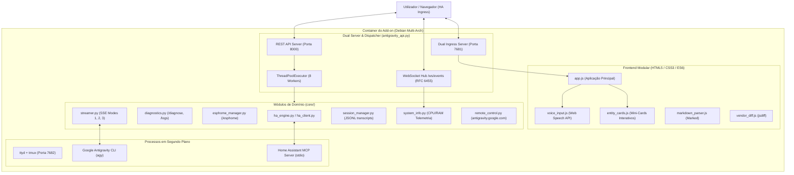

# Guia de Arquitetura e Manutenção — Google Antigravity CLI Add-on

Este documento descreve detalhadamente a arquitetura interna, a divisão de responsabilidades, os padrões de código e os procedimentos de manutenção do add-on **Google Antigravity CLI** para Home Assistant.

---

## 1. Visão Geral da Arquitetura

O add-on opera como uma ponte bidirecional entre o ecossistema do **Home Assistant** e o **Google Antigravity CLI (`agy`)**, fornecendo uma interface visual moderna (Ingress), um terminal web persistente (`tmux` + `ttyd`) e um hub de eventos em tempo real.



---

## 2. Estrutura de Ficheiros & Princípio da Responsabilidade Única (SRP)

O projeto segue rigorosamente o princípio da responsabilidade única (*Single Responsibility Principle*). Nenhum ficheiro deve concentrar múltiplas responsabilidades desnecessárias (*no god-scripts*).

### 2.1 Backend (`core/`)

| Ficheiro | Responsabilidade Primária | Dependências Principais |
|---|---|---|
| [`antigravity_api.py`](file:///addons/antigravity-cli/antigravity_api.py) | Ponto de entrada, roteamento HTTP/REST, dispatch assíncrono e proxy ttyd | `http.server`, `socket`, `threading` |
| [`core/diagnostics.py`](file:///addons/antigravity-cli/core/diagnostics.py) | Leitura e análise de logs (`home-assistant.log`), deteção de erros e entidades offline | `re`, `pathlib`, `dataclasses` |
| [`core/esphome_manager.py`](file:///addons/antigravity-cli/core/esphome_manager.py) | Descoberta de ficheiros YAML em `/config/esphome`, deteção de portas USB e compilação | `subprocess`, `glob`, `pathlib` |
| [`core/websocket_hub.py`](file:///addons/antigravity-cli/core/websocket_hub.py) | Servidor WebSocket nativo (RFC 6455) para difusão contínua de telemetria | `hashlib`, `base64`, `struct` |
| [`core/ha_engine.py`](file:///addons/antigravity-cli/core/ha_engine.py) | Resolução ultra-rápida de intenções smart home sem invocar subprocessos de IA | `core.ha_client`, `core.sensors` |
| [`core/ha_client.py`](file:///addons/antigravity-cli/core/ha_client.py) | Cliente HTTP / WebSocket para comunicação com a API REST do Home Assistant | `urllib.request`, `json` |
| [`core/streamer.py`](file:///addons/antigravity-cli/core/streamer.py) | Motor de Server-Sent Events (SSE) para streaming das respostas do assistente nos Modos 1, 2 e 3 | `subprocess`, `threading`, `select` |
| [`core/session_manager.py`](file:///addons/antigravity-cli/core/session_manager.py) | Persistência e gestão de transcrições de sessões em JSONL (`.gemini/brain/`) | `json`, `os`, `pathlib` |
| [`core/remote_control.py`](file:///addons/antigravity-cli/core/remote_control.py) | Gestão do daemon `agy remote-control serve` e integração com `antigravity.google.com` | `subprocess`, `time` |
| [`core/system_info.py`](file:///addons/antigravity-cli/core/system_info.py) | Recolha de telemetria de CPU, memória, arquitetura e verificação de suporte a hardware | `os`, `sys` |
| [`core/renderers.py`](file:///addons/antigravity-cli/core/renderers.py) | Geradores de Markdown responsivo e tags semânticas `<ha-entity>` para a UI | `core.sensors` |
| [`core/codesearch.py`](file:///addons/antigravity-cli/core/codesearch.py) | Pesquisa de código no workspace via grep nativo (comando `/codesearch`) | `os`, `re` |
| [`core/uploads.py`](file:///addons/antigravity-cli/core/uploads.py) | Processamento de anexos e uploads para o modo de raciocínio profundo | `pathlib`, `shutil` |
| [`core/web_ui.py`](file:///addons/antigravity-cli/core/web_ui.py) | Renderizador do HTML principal com suporte a links estáticos ou inlining retrocompatível | `core.ui` |

### 2.2 Frontend (`core/ui/static/`)

| Ficheiro | Responsabilidade Primária |
|---|---|
| [`static/js/app.js`](file:///addons/antigravity-cli/core/ui/static/js/app.js) | Lógica central da aplicação SPA: gestão de chat, sidebar, histórico, envio de mensagens e comandos slash |
| [`static/js/voice_input.js`](file:///addons/antigravity-cli/core/ui/static/js/voice_input.js) | Controlador autónomo da Web Speech API (STT): microfone, deteção de idioma (`pt-PT`), transcrição em tempo real |
| [`static/js/entity_cards.js`](file:///addons/antigravity-cli/core/ui/static/js/entity_cards.js) | Parser e montador de mini-cards interativos de entidades (`<ha-entity>`, `[entity:id]`), sincronização e chamadas à API |
| [`static/js/markdown_parser.js`](file:///addons/antigravity-cli/core/ui/static/js/markdown_parser.js) | Parser Markdown com suporte a syntax highlighting e blocos de código |
| [`static/js/vendor_diff.js`](file:///addons/antigravity-cli/core/ui/static/js/vendor_diff.js) | Visualizador de diffs linha a linha (jsdiff) |
| [`static/css/app.css`](file:///addons/antigravity-cli/core/ui/static/css/app.css) | Estilização completa da aplicação, design system responsivo e temas Dark/Light |
| [`static/templates/body.html`](file:///addons/antigravity-cli/core/ui/static/templates/body.html) | Marcação estrutural do corpo da página (header, sidebar, chat, terminal helper) |
| [`static/index.html`](file:///addons/antigravity-cli/core/ui/static/index.html) | Shell HTML principal que liga os ficheiros CSS e JS modulares |

---

## 3. Modos de Operação do Assistente (`chat_mode`)

1. **Modo 1 (`fast_only` - Fast Control Mode)**:
   - Respostas instantâneas (< 0.05s) para consulta de estados, controlo direto de luzes, interruptores, clima e resumo da casa.
   - Não inicia o subprocesso do CLI `agy`, economizando 200–300MB de RAM.
2. **Modo 2 (`full` - Standard Control + Reasoning Mode)**:
   - Combina o motor rápido com transição inteligente para o agente de IA quando a consulta envolve raciocínio complexo.
3. **Modo 3 (`cli_reasoning` - Deep Reasoning Mode)**:
   - Executa o agente completo do Google Antigravity CLI com ferramentas do MCP `ha-mcp` (88+ ferramentas).
   - Suporta anexação de ficheiros, inspeção de automações e raciocínio profundo em cadeia de passos (*step-by-step reasoning*).

---

## 4. Guia de Manutenção e Procedimentos Práticos

### 4.1 Como Adicionar um Novo Comando de Barra (Slash Command)

1. **Definir a lista no frontend** em [`core/ui/static/js/app.js`](file:///addons/antigravity-cli/core/ui/static/js/app.js):
   - Adicionar o objeto ao array `SLASH_COMMANDS`:
     ```javascript
     { cmd: '/meucomando', usage: '/meucomando [arg]', desc: 'Descrição do comando', insertSuffix: ' ' }
     ```
2. **Criar a função de execução** no `app.js`:
   - Exemplo: `async function runMeuComando(streamMode, arg) { ... }`
   - Use `createBotStreamMessage(streamMode)` para criar a bolha do assistente e `streamUI.setText(...)` para renderizar o resultado.
3. **Registar o despachador** em `sendMessage()` dentro de `app.js`:
   ```javascript
   if (typedText.toLowerCase().startsWith('/meucomando')) {
     await runMeuComando(streamMode, arg);
     return;
   }
   ```
4. **Implementar o endpoint correspondente** em [`antigravity_api.py`](file:///addons/antigravity-cli/antigravity_api.py) caso necessite de dados do backend, delegando sempre a lógica pesada para um módulo específico em `core/`.

### 4.2 Como Adicionar um Novo Mini-Card Interativo de Entidade

1. No frontend, estenda [`core/ui/static/js/entity_cards.js`](file:///addons/antigravity-cli/core/ui/static/js/entity_cards.js):
   - No mapa `DOMAIN_ICONS`, adicione o ícone do domínio (ex.: `lock: '🔒'`).
   - No método `renderCardHtml(card)`, adicione o bloco de controlo para o novo domínio (ex.: botões trancar/destrancar).
2. As ações do utilizador devem chamar `window.EntityCards.callService(entityId, domain, service, data)` que contacta `POST /api/device/control`.
3. No backend, se pretender que o motor gere o card diretamente numa resposta de texto, use:
   ```python
   from core.renderers import render_entity_card_tag
   resposta = f"Luz alterada com sucesso:\n{render_entity_card_tag('light.sala_teto', state='on')}"
   ```

---

## 5. Convenções de Código e Diretrizes do Workspace

Ao modificar ou estender qualquer componente deste repositório, devem ser respeitadas as seguintes regras:

1. **Regra Semântica de Entidades Home Assistant (GEMINI.md)**:
   - Formato estrito: `<domain>.<area>_<funcao>_<qualificador>`
   - Exemplo: `sensor.sala_ac_power`, `light.quarto_duarte_teto_1`, `switch.garagem_maquina_lavar`.
2. **Concorrência Não-Bloqueante**:
   - Nunca efetue operações síncronas de longa duração (downloads, compilações pesadas, timeouts de rede) na thread principal do servidor HTTP. Use sempre `ASYNC_EXECUTOR.submit(...)` ou subprocessos assíncronos.
3. **Preservação de Créditos e Autoria**:
   - Manter sempre o reconhecimento e crédito ao autor original **dugurs** na documentação, README e cabeçalhos históricos.
4. **Retrocompatibilidade nos Loaders Python**:
   - Mantenha os loaders `core/ui/scripts.py`, `styles.py` e `templates.py` atualizados para carregar os novos ficheiros estáticos quando o modo de template embutido (inline) for solicitado.
5. **Normalização de Linhas (LF)**:
   - Todos os ficheiros do repositório devem ser salvos com finais de linha Unix (`\n` - LF) para evitar incompatibilidades entre Windows e containers Linux.

---

## 6. Procedimento de Teste Local & Validação

1. **Verificação de Sintaxe JavaScript**:
   ```bash
   node -c addons/antigravity-cli/core/ui/static/js/app.js
   node -c addons/antigravity-cli/core/ui/static/js/voice_input.js
   node -c addons/antigravity-cli/core/ui/static/js/entity_cards.js
   ```
2. **Verificação de Compilação Python**:
   ```bash
   python -m py_compile addons/antigravity-cli/antigravity_api.py
   python -m py_compile addons/antigravity-cli/core/diagnostics.py
   python -m py_compile addons/antigravity-cli/core/esphome_manager.py
   ```
3. **Execução de Testes Unitários de Regressão**:
   ```bash
   python scratch/test_diagnostics.py
   python scratch/test_esphome_manager.py
   ```
4. **Construção e Teste no Podman (WSL)**:
   ```bash
   wsl.exe -d podman-machine-default -u root podman build -t antigravity-cli:test addons/antigravity-cli
   wsl.exe -d podman-machine-default -u root podman run -d --name antigravity-podman-web -p 8080:8000 -p 7681:7681 localhost/antigravity-cli:test
   ```
